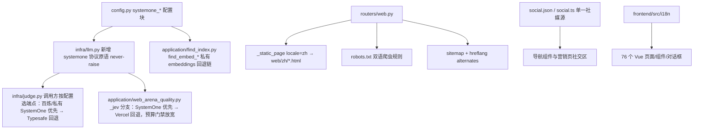

## 产品概述

对 treg（工具目录与代理服务，FastAPI 后端 + Vue 仪表盘 + 服务端营销站）做四条工作流的二次开发，使其适配中文用户与国内环境，同时不破坏任何现有代理/计费/SEO 不变量。

## 核心功能

1. **内部模型私有化（SystemOne 协议直连）**：treg 自身两处 SystemOne 协议调用（`infra/judge.py` 相关性 judge、`application/web_arena_quality.py` 的 JEV 评测）统一支持自定义 SystemOne 兼容端点——**阿里云百炼 decision-model（`POST {base_url}/systemone`，model `decision-model-preview`）或私有化部署的 SystemOne**；`base_url / api_key / model / 超时` 各自可配，默认留空走现有 Typesafe SystemOne / Vercel AI Gateway 回退。语义 embeddings（`find_embed_*`）本已是 OpenAI 兼容可配，仅补私有端点回退链。注意：`providers.py` 中的 OpenAI/Anthropic 等是被收录代理的 provider 目录，不在改造范围。
2. **中英文国际化**：Vue 仪表盘（76 个 .vue）与服务端营销静态站（`src/treg/web/` 30+ HTML）全量中英双语；Vue 侧提供语言切换器与 localStorage 持久化；营销站按 URL 前缀 `/zh/` 提供独立可收录的中文页，并对 `/` 做 Accept-Language 协商；`llms.txt`、`skill.md`、`README.md`、`AGENTS.md` 等 agent-facing 文件保持英文（明确豁免）。
3. **国内社媒**：新增微博、小红书、抖音、微信四个平台入口，收敛为单一配置数据源（前后端共用一份清单），微信采用二维码弹窗方案；链接先用占位符，账号开好后一处配置替换。覆盖 LandingNavigation / DashboardNavigation / PublicNavigation 及营销页 astra.html、aeo.html 社交区。
4. **国内 AEO/SEO**：robots.txt 显式列出国内 AI/搜索爬虫（Baiduspider、Bytespider、YisouSpider、Sogou、360Spider 等）并保持现有禁止路径不变；新增百度站长主动推送脚本（复用 indexnow_submit.py 模式）；aeo.html 产品演示（英文版 + 中文版）加入 Kimi、豆包、腾讯元宝、文心一言、通义千问、DeepSeek 等国内平台；中文页补齐 JSON-LD zh-CN、hreflang 双语互链与 sitemap alternates。

## 技术栈

- 后端：FastAPI + uv 管理（现有栈，零新增依赖；HTTP 客户端复用 httpx）
- 前端：Vue 3 + Vite（现有栈，零新增依赖，走 registry.npmmirror.com）
- 测试：pytest（`uv run --with pytest-xdist pytest -n auto -q`）、`npm --prefix frontend test`、`npm --prefix frontend run check`

## 实现方案

### 1. SystemOne 协议统一客户端（新增 `src/treg/infra/llm.py`）

**线协议同构确认**（调研实证）：`judge.py:162-166` 请求体 `{"state": {...}, "model": ..., "questions": {...}}`、响应 `{"answers": {...}, "usage": {"input_tokens","output_tokens"}}`；`web_arena_quality.py:59-66` 的 JEV 请求 `{state, questions}`（model 经 `ai-model-id` 头）、响应同构（usage 字段为 `inputTokens` Vercel 变体）。用户提供的百炼接口 `POST https://llm-....maas.aliyuncs.com/compatible-mode/v1/systemone`，body `{"model": "decision-model-preview", "state": {...}, "questions": {...}}` 与该协议完全一致——**是原生 drop-in，无需任何格式适配**。

仿照 `infra/embed.py` 模式：模块只懂线格式、绝不抛异常（超时/非 200/坏包体返回 `answers=None, reason`），调用方降级。提供唯一原语：

```python
async def systemone(state: dict, questions: dict, *, base_url: str, api_key: str,
                    model: str = "", timeout_s: float = 8.0,
                    transport: httpx.AsyncBaseTransport | None = None
                    ) -> tuple[dict | None, dict]:
    """POST {base_url}/systemone（base_url 已以 /systemone 结尾则不重复追加）。
    返回 (answers, meta)；meta 含 ms/usage（兼容 input_tokens 与 inputTokens 两种拼写）/error。
    认证：Authorization: Bearer {api_key}（DashScope compatible-mode 标准形态，接受 Bearer；
    如私有化部署要求裸 key，追加 config 项 systemone_auth_scheme: "bearer"|"raw"，默认 bearer）。"""
```

`config.py` 新增配置块（TREG_ 前缀 env 自动映射）：

```python
# 私有化 SystemOne 决策/评测端点（百炼 decision-model 或自部署）。留空 = 全部走原供应商回退。
systemone_base_url: str = ""   # 如 https://llm-....cn-beijing.maas.aliyuncs.com/compatible-mode/v1
systemone_api_key: str = Field(default="", repr=False)   # 即 DASHSCOPE_API_KEY
systemone_model: str = ""      # 如 decision-model-preview
systemone_timeout_s: float = 8.0
systemone_auth_scheme: str = "bearer"   # bearer | raw
```

两处接入（各自保持原契约、缓存与回退语义）：

- **judge（`infra/judge.py`）**：`judge()` 函数签名不动（仍收 `api_key/model/url` 参数）——**端点选择决策放在调用方**（`application/search_experiment` 组装参数处）：`settings.systemone_base_url` 配齐时传百炼/私有 SystemOne 的三元组，否则传现有 `typesafe_url/model/api_key`。进程内缓存键已含 model，天然隔离不同端点；“弃权不抛错”、401/402/403 断供降级日志全部不变。
- **JEV 评测（`application/web_arena_quality.py`）**：`_jev()` 内部按 `settings.systemone_base_url` 分支——配置时改调 `infra.llm.systemone`（model 进 body，`answers`/usage 解析复用），否则走原 Vercel `JEV_URL`。**`_take_budget` 配额门禁同步调整**：现有 `if not settings.ai_gateway_api_key: return False` 放宽为 `ai_gateway_api_key` 与 `systemone_base_url+systemone_api_key` 任一配齐即可准入；`jev_cost_usd` 成本记录逻辑保留（usage tokens 存在时照记，字段缺失记 None）。
- **embeddings（`application/find_index.py` + `infra/embed.py`）**：现有 `find_embed_url/model/api_key` 已是 OpenAI 兼容可配——仅补齐：`find_embed_api_key` 为空且 URL 非 openrouter 时支持回退 `systemone_api_key`（仅当 base_url 同源），并在文档写明维度语义（私有嵌入模型换维度凭 `model_slug` 天然隔离缓存，不混向量）。
- `jev_xboost.py` 的 /jev 演示保留原逻辑（仅 `ai_gateway_api_key` 配置时启用，真实计费演示不受影响）。

### 2. Vue i18n（零依赖自研，frontend/src/i18n/）

- `i18n/en.ts` + `i18n/zh-CN.ts`：扁平 key 词表，两份 key 集合必须完全对齐（dev 断言 + vitest 测试）。
- `i18n/index.ts`：模块级 `locale` ref（初始值 `localStorage['treg-locale']` → 浏览器语言 → 'en'），`t(key, params?)`、`setLocale()` 同步 localStorage 与 `document.documentElement.lang`；与现有 `treg-theme` 持久化模式对齐。
- 组件内 `import { t } from '@/i18n'` 直接调用（无 provide/inject 开销）；语言切换按钮加入三个导航组件。
- 76 个 .vue 全量替换硬编码文案；用 code-explorer 子代理先产出“文件 → 硬编码字符串”清单再批量抽取，避免遗漏。
- `index.html` 的 "Loading treg…" 用内联脚本按 localStorage 先行设 lang。

### 3. 营销站中文化（URL 前缀方案）

- 新增 `src/treg/web/zh/` 目录存放中文版 HTML（共享页面级翻译，非机翻占位）。
- `routers/web.py`：`_static_page(name, request, locale='en')` 扩展 locale 参数——locale 为 zh 时优先读 `zh/<name>`，`{BASE}` 填充为 `public_url`（canonical 指向自身）；新增 `/zh/...` 路由族映射同名页面；`/` 与核心落地页读 `Accept-Language` 做 302 协商（显式 URL 优先于 Cookie，Cookie 优先于 Accept-Language，带 `Vary: Accept-Language`）。
- 每个 en/zh 页面互加 `<link rel="alternate" hreflang>`，英文页指向 `public_url`、中文页指向 `public_url/zh/...`；sitemap 为双语页输出 `xhtml:link` alternates；中文页 JSON-LD 标注 `inLanguage: zh-CN`。
- 动态目录内容（catalog 数据、agent_pages 正文）保持英文，仅翻译页面 chrome 与营销文案；`marketing/landing/build_html.py` 生成的落地页纳入翻译范围。

### 4. 社媒单一数据源

- 前端 `frontend/src/state/social.ts`：`{ platform, label, url, kind: 'link' | 'qrcode' }[]`（含现有 GitHub/Discord/X + 新增 weibo/xiaohongshu/douyin/wechat），URL 占位符 `https://weibo.com/treg` 等，集中注释“账号开通后仅改此文件”。
- 后端 `src/treg/web/social.json`（营销页占位符填充消费），与前端清单保持同构；微信条目 `kind: qrcode`，二维码图片放 `src/treg/web/media/`（先用占位图）。
- 微信二维码弹窗：新 Vue 组件 `WeChatQrDialog.vue`（复用现有 dialog 指令体系）；内联 SVG 图标补齐四平台。
- 替换点：LandingNavigation.vue、DashboardNavigation.vue、PublicNavigation.vue、astra.html、aeo.html 社交区。

### 5. 国内 AEO/SEO

- `src/treg/web/robots.txt`：保持现有 disallow 不变，显式追加 `User-agent` 段（Baiduspider、Bytespider、YisouSpider、Sogou web spider、360Spider 及国际 AI 爬虫 GPTBot/ClaudeBot/PerplexityBot/Google-Extended 允许规则）；同步更新 `tests/test_seo.py`。
- 新增 `scripts/baidu_push.py`：百度站长主动推送（`zz.baidu.com` 接口，读 `TREG_BAIDU_PUSH_TOKEN` env，推送 sitemap 中的英文+中文 URL），复用 `scripts/indexnow_submit.py` 的参数与日志风格。
- `aeo.html`（及 zh 版）：演示平台列表加入 Kimi、豆包、腾讯元宝、文心一言、通义千问、DeepSeek。
- llms.txt 保持英文不动（agent-facing 豁免）。

## 架构设计



## 实施要点

- 遵守 import-linter 分层：`infra/llm.py` 只懂线格式不做决策；SystemOne vs 原供应商的端点选择决策放在调用方（application 层组装参数 / `_jev` 分支），与“infra 不做决策”契约一致。
- 密钥安全：`systemone_api_key` 用 `Field(repr=False)`，任何日志只记 error 类型不记包体/密钥；凭据只经 TREG_* env 注入，不入仓库（AGENTS.md 契约）。
- 百炼对接细节：Authorization 用 `Bearer` 前缀（DashScope compatible-mode 标准，接受 Bearer；预留 `systemone_auth_scheme` 兼容裸 key 的私有部署）；usage 解析同时兼容 `input_tokens`（SystemOne/Typesafe）与 `inputTokens`（Vercel）两种拼写；`model` 位置差异（body vs `ai-model-id` 头）由分支各自处理。
- 性能：judge 已有进程内缓存（键含 model，天然区分端点），internal 分支沿用；`systemone_timeout_s` 默认 8s（决策模型响应稍慢，不拖垮搜索链路仍有 judge 弃权兜底）；i18n 词表按模块拆分并在构建期 tree-shake。
- 回退即回滚：`systemone_*` 配置留空 = 行为与现状完全一致（blast radius 为零），可灰度。
- docs 同 PR：更新 `docs/context/interface/seo.md`、新增/更新 i18n 与 internal-llm 的 context 片段；README/AGENTS.md 四文件一致性检查（llms.txt 本次豁免不动）。

## 目录结构

```
src/treg/
├── infra/llm.py                          # [NEW] SystemOne 协议原语，never-raise，仿 embed.py
├── infra/judge.py                        # [MODIFY] 支持外部传入 SystemOne 端点三元组（签名不变，决策在调用方）
├── application/web_arena_quality.py      # [MODIFY] _jev SystemOne 分支 + _take_budget 门禁放宽
├── application/find_index.py             # [MODIFY] 私有 embeddings 端点回退链
├── application/search_experiment.py      # [MODIFY] judge 端点选择：systemone_* 优先 → typesafe 回退
├── config.py                             # [MODIFY] systemone_* 配置块
├── routers/web.py                        # [MODIFY] _static_page locale、/zh 路由族、Accept-Language 协商
├── web/zh/                               # [NEW] 中文版营销页（landing/aeo/usecase 等同名镜像）
├── web/social.json                       # [NEW] 社媒单一数据源（后端侧）
├── web/robots.txt                        # [MODIFY] 国内 AI 爬虫显式规则
scripts/
├── baidu_push.py                         # [NEW] 百度站长主动推送
frontend/src/
├── i18n/index.ts|en.ts|zh-CN.ts          # [NEW] 零依赖 i18n
├── state/social.ts                       # [NEW] 社媒清单（前端侧）
├── components/WeChatQrDialog.vue         # [NEW] 微信二维码弹窗
├── components/*Navigation.vue 等 76 个   # [MODIFY] 文案抽取 $t() + 语言切换 + 社媒区
docs/context/...                         # [MODIFY] seo.md 与新片段，同 PR
tests/
├── test_seo.py / test_static_pages.py    # [MODIFY] /zh、robots、hreflang 断言
├── test_internal_llm.py                  # [NEW] systemone 原语 + judge/JEV 回退链单测
```